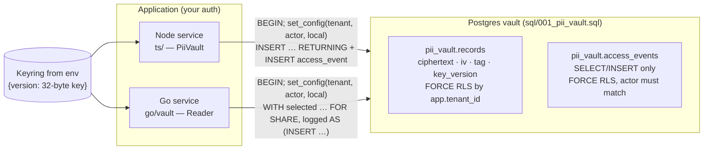

# pii-vault

Field-level encryption for restricted PII in Postgres: AES-256-GCM with
per-record HKDF keys, a rotating keyring, byte-for-byte compatible Node and Go
implementations, and an access log that is written in the same SQL statement
as every read.

## Why this exists

This was extracted from a production dealership management platform that has
to hold SSNs, dates of birth, license numbers and credit data for its
customers' buyers. The operational database was a document store that also did
authorization, which is the wrong place for ciphertext and the wrong place for
an audit trail an attacker with app access could edit. The answer was a
separate Postgres vault: ciphertext only, tenant isolation enforced by forced
row-level security, an append-only access log the runtime cannot rewrite, and
keys that never touch the database. A TypeScript service writes; a Go service
reads the same rows for document generation, so both sides have to agree on
every byte.

## Architecture



**Per-record keys, bound context.** Each value is sealed with AES-256-GCM
under a key derived by HKDF-SHA256 from the active master key, salted with the
tenant id and labelled with the vault id, owner and field type. The same
identity, plus the key version, is the GCM associated data. A ciphertext
copied to another tenant, owner, field or row fails authentication rather than
decrypting as someone else's SSN, and a compromise of one derived key exposes
one record.

**Versioned keyring.** `PII_VAULT_KEYRING` maps versions to keys;
`PII_VAULT_ACTIVE_KEY_VERSION` picks the one new writes use. Every row records
its version, so rotation is "add a version, deploy to readers, switch writers,
re-seal, retire" with no flag day. Configuration fails closed: a key that is
not exactly 32 bytes, or an active version not in the ring, is a startup error.

**Node and Go agree byte for byte.** The AAD is `JSON.stringify` of a fixed
key order; Go reproduces it with `encoding/json` and patches the one place the
two disagree (U+2028/U+2029, which Go escapes and JavaScript does not). Go
also accepts every base64 spelling Node's `Buffer.from` does. Shared vectors in
`testdata/vectors.json` pin all of it, including the intermediate AAD and HKDF
output so a regression names the step that diverged.

**Every read through the vault writes its access record.** The read is one statement:
a `selected` CTE takes the row `FOR SHARE`, a `logged` CTE inserts one access
event per selected row, and the final `SELECT` joins them. If the event
violates a constraint (reason too short, actor not the one bound to the
transaction), the statement fails and no ciphertext leaves the database. The
runtime role has `SELECT, INSERT` on the log and nothing else, so it cannot
cover its tracks either.

**The runtime refuses unsafe logins.** RLS is only as good as the role it
applies to. On first use (Node) or every new pooled connection (Go), the
library checks the catalog and refuses superusers, `BYPASSRLS` roles, owners
of the vault tables or schema, roles that could rewrite the log, and any login
names you configure as forbidden. A misconfigured connection string fails at
startup, not in a breach report.

**Tradeoffs.** Field encryption means no `WHERE ssn = …` queries; lookups go
through the owner id and the masked `display_hint` covers list views. The
tenant is bound with transaction-local `set_config`, so every operation is a
short transaction (one extra round trip) in exchange for no tenant leaking
across pooled connections. The vault id is part of the key, so replacing a
value keeps its id; the store refuses a replacement under a new id rather than
silently writing a ciphertext that can never open.

**Threat model.** RLS and the atomic access log protect against bugs in your
own handlers: a query that forgets the tenant, a code path that skips logging.
They do not stop someone who holds the runtime database credential. That role
can `SELECT` ciphertext directly without a log row, and it can bind any tenant
with `set_config`. What it still cannot do is read plaintext without the
keyring, or edit or delete the access log. Keep the keyring and the database
credential in separate secret stores so one leak is not both.

More detail, including the rotation procedure: [docs/SECURITY.md](docs/SECURITY.md).

## Quick start

Requires Docker, Node 20+ and Go 1.24+.

```bash
make install
make demo        # starts postgres:16 via docker compose, runs ts/examples/demo.ts
```

The demo uses `.env.example`, whose keyring is obviously fake (each key is one
byte repeated 32 times). It:

1. checks the runtime role is RLS-safe,
2. stores synthetic SSN / DOB / income for two tenants,
3. reads one value back with an audit reason,
4. prints the raw `pii_vault.records` row (ciphertext, IV, tag, key version, masked hint),
5. prints the access-log rows (`create`, then the `read` written in the same statement),
6. shows tenant B being refused tenant A's record, a raw `SELECT` with no
   tenant filter returning 0 rows under RLS, and `DELETE FROM access_events`
   being denied,
7. shows a `BYPASSRLS` login being refused, and
8. reads the same records with the Go reader (`go run ./go/cmd/vault-read`).

### Using it

```ts
import { PiiVault } from "pii-vault"; // ts/src/index.ts

const vault = new PiiVault({
  databaseUrl: process.env.PII_VAULT_DATABASE_URL!,  // the runtime login
  forbiddenLoginRoles: ["postgres"],                  // your provider's owner role
});                                                   // keyring from PII_VAULT_KEYRING

const { vaultId, masked } = await vault.storeVaultRecord({
  actor: { tenantId, userId, role },   // from YOUR authenticated session
  vaultId: crypto.randomUUID(),
  ownerType: "client", ownerId, type: "ssn", plaintext: "123-45-6789",
  expiresAt: Date.now() + 365 * 86_400_000,
  reason: "Credit application intake", requestId, replacingExisting: false,
});

const { plaintext } = await vault.retrieveVaultRecord({
  actor, vaultId, reason: "Generating the signed credit application", requestId,
});
```

```go
keys, _ := vault.ParseKeyring(os.Getenv("PII_VAULT_KEYRING"))
reader, err := vault.Open(ctx, os.Getenv("PII_VAULT_DATABASE_URL"), keys,
	vault.WithForbiddenLoginRoles("postgres"))
values, err := reader.Read(ctx, vault.Actor{UserID: userID, Role: role},
	tenantID, "client", ownerID, []string{"ssn", "date_of_birth"}, "Generating the signed credit application")
```

### Real keys

```bash
make keyring                     # prints PII_VAULT_KEYRING=… and PII_VAULT_ACTIVE_KEY_VERSION=1
cd ts && PII_VAULT_KEYRING='…' npx tsx scripts/generate-keyring.ts --rotate   # adds version N+1
```

Put the output in your secret manager. Never commit `.env`.

### Production database setup

Apply `sql/001_pii_vault.sql` as the owner, then create a separate login that
inherits `pii_vault_app` (the commented block at the end of the migration, or
`docker/initdb/010_local_logins.sql` for the local version). Point
`PII_VAULT_DATABASE_URL` at that login only.

## Tests

```bash
make test-unit          # no database: TS unit + interop, Go unit + interop
make test-integration   # starts postgres:16 and runs both suites against it
make test               # both
```

| Suite | What it proves |
| --- | --- |
| `ts/test/vaultCrypto.test.ts` | Round trip, fresh IV per write, tamper detection on ciphertext/IV/tag, context binding for tenant/vault/owner/field/version, rotation keeps old versions readable and retiring a version breaks only its records, keyring fails closed, per-type validation and masking. |
| `ts/test/interop.test.ts`, `go/vault/vault_test.go` | Node opens every Go-sealed vector and Go opens every Node-sealed vector; each side reproduces the other's exact AAD, HKDF output and ciphertext from the same IV (including Unicode and U+2028 edge cases); committed vectors are current. |
| `ts/test/vault.integration.test.ts` | Against Postgres: plaintext never reaches a row; exactly one `read` event per read; a read whose event cannot be logged returns nothing; an event for a different actor is rejected; RLS (not the `WHERE` clause) hides other tenants' rows, including with no tenant bound; cross-tenant update/delete/insert are no-ops or errors; `UPDATE`/`DELETE`/`TRUNCATE` on the access log fail with `42501`; v1 and v2 records read side by side after rotation; superuser and `BYPASSRLS` logins are refused; the Go reader opens and audits rows the Node library stored. |
| `go/vault/integration_test.go` | The same guarantees from the Go reader: atomic per-record read logging, empty cross-tenant reads with nothing logged, append-only log, rotation, unsafe logins refused. |

Regenerate the vectors with `make vectors` (Node writes its half, then Go adds
its half). CI regenerates them and fails on any diff.

## What was left out

The original lived inside a larger platform: its authorization layer (role and
permission checks, tenant resolution from the identity provider, owner-id
validation against real customer records), the server-function wrappers around
these calls, the legacy-field migration tooling, and the product's other
tables are not here. The Node side originally used a serverless HTTP driver;
here it uses `pg`. The Go reader originally keyed records by the operational
store's ids; here tenant and owner ids are opaque strings. An expiry purge job,
alerting, and credential rotation are listed as known limits in
[docs/SECURITY.md](docs/SECURITY.md).
