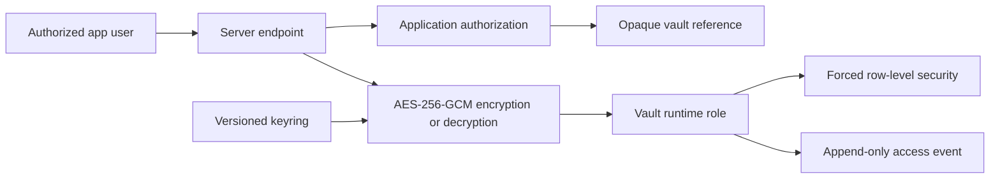

# PII vault security architecture

## Decision

The application database is the operational store and the authorization
boundary. A dedicated Postgres database is the restricted-data vault. Neither
system alone is enough to disclose a protected value:

| Concern | Application | Vault database |
| --- | --- | --- |
| Users, tenants, customers | Source of truth | Not stored |
| Authorization and tenant membership | Enforced | Receives derived tenant context |
| Vault reference, type, expiry, state | Stored | Stored with ciphertext |
| Restricted plaintext | Transient inside an authenticated server call | Never stored |
| Encrypted value | Never stored | Stored |
| Encryption key | Server environment / secret manager only | Never stored |
| Detailed vault access events | Optional metadata | Append-only runtime access |

Browsers, desktop apps and mobile apps must never connect to the vault or
receive a vault credential.

## Restricted data

The vault supports:

- Social Security number
- Driver's license number
- Date of birth
- Credit score
- Monthly income
- Housing payment
- Preapproval maximum
- Trade payoff
- Co-buyer name
- Co-buyer credit score
- Bank account identifier
- Tax ID
- Passport number
- A narrowly reviewed custom restricted value

Payment card data and medical records are deliberately unsupported. Card data
must be tokenized by a PCI-compliant payment processor and never pass through
this vault.

A primary customer's name, email address, phone number and postal address are
expected to stay operational contact data in the application database. They are
still personal data and require tenant checks, retention rules, export controls
and incident handling, but keeping them there allows normal search and
workflows without decrypting the restricted vault. Co-buyer identity is kept in
the vault because it is part of the restricted underwriting profile.

## Request path

The tenant is derived from the authenticated identity. Vault-facing endpoints
should not accept a tenant id from the client. Owner ids should be resolved
back to a real application record and checked against that tenant before they
reach the vault.

## Cryptography

- AES-256-GCM provides encryption and integrity.
- A fresh 96-bit IV is generated for each write.
- HKDF-SHA-256 derives a record key from the versioned master key
  (salt `tenant:<tenantId>`, info `pii-vault:<vaultId>:<ownerType>:<ownerId>:<fieldType>`).
- Associated data binds the ciphertext to service, purpose, tenant, vault id,
  owner type, owner id, field type and key version.
- A changed tenant or owner context makes decryption fail authentication.
- Master keys must decode to exactly 32 bytes and configuration fails closed.

Key material is supplied with `PII_VAULT_KEYRING`, for example
`{"1":"<base64 key>"}`. `PII_VAULT_ACTIVE_KEY_VERSION` controls new writes.
Old keys remain available only during verified rotation.

### Rotation procedure

1. `PII_VAULT_KEYRING='<current>' npx tsx scripts/generate-keyring.ts --rotate`
   (from `ts/`) adds version N+1 to the existing keyring.
2. Deploy the extended keyring to every reader (Node and Go) with the active
   version still at N.
3. Switch writers to `PII_VAULT_ACTIVE_KEY_VERSION=N+1`.
4. Re-seal records still on version N (read, then store under the same vault id).
5. Remove version N from the keyring only after no row references it:
   `SELECT key_version, count(*) FROM pii_vault.records GROUP BY 1`.

## Authorization (caller's responsibility)

The vault library does not decide who may read what; it records who did. A
reasonable policy, and the one it was designed alongside:

- Write and read: tenant admin or manager, or an explicit `pii:write` /
  `pii:read` permission.
- Delete: tenant admin, or `pii:delete`.
- Audit history: tenant admin, or `pii:audit`.
- Reads, deletes and audit-history reads require a reason between 10 and 500
  characters (enforced by the database: the access event cannot be written
  without one, so neither can the read).

## Database isolation

The migration at `sql/001_pii_vault.sql`:

- enables and forces row-level security on records and events;
- defaults to no rows when `app.tenant_id` is absent;
- requires actor context for access-event inserts;
- grants the application role only the operations the runtime uses;
- denies update, delete and truncate on access events; and
- keeps the runtime login separate from schema ownership.

Both runtimes independently refuse superusers, roles with `BYPASSRLS`, the
owner of the vault tables or schema, any role that could rewrite the access
log, and any login name you list as forbidden (your provider's owner role).

## Known limits

- An expiry purge job is not included; records past `expires_at` are hidden
  from reads but not deleted.
- The access log grows without bound; archive by partition or export.
- No alerting on failed vault operations or unusual access volume is
  included.
- Database credential rotation is outside the scope of this library.
